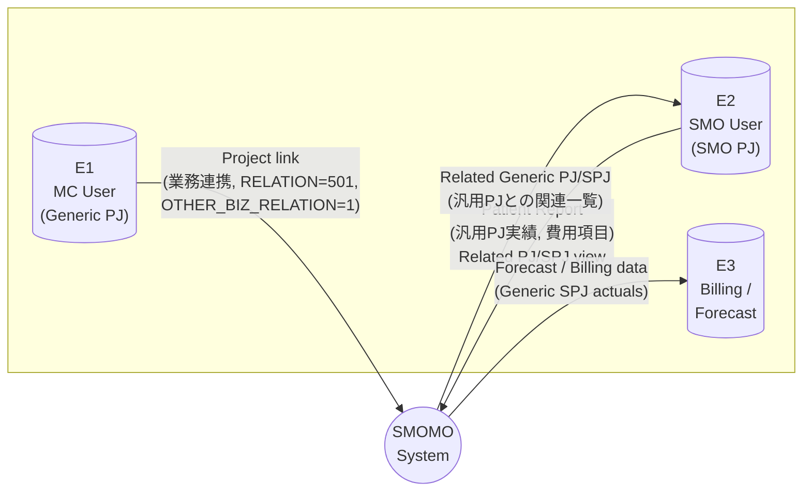
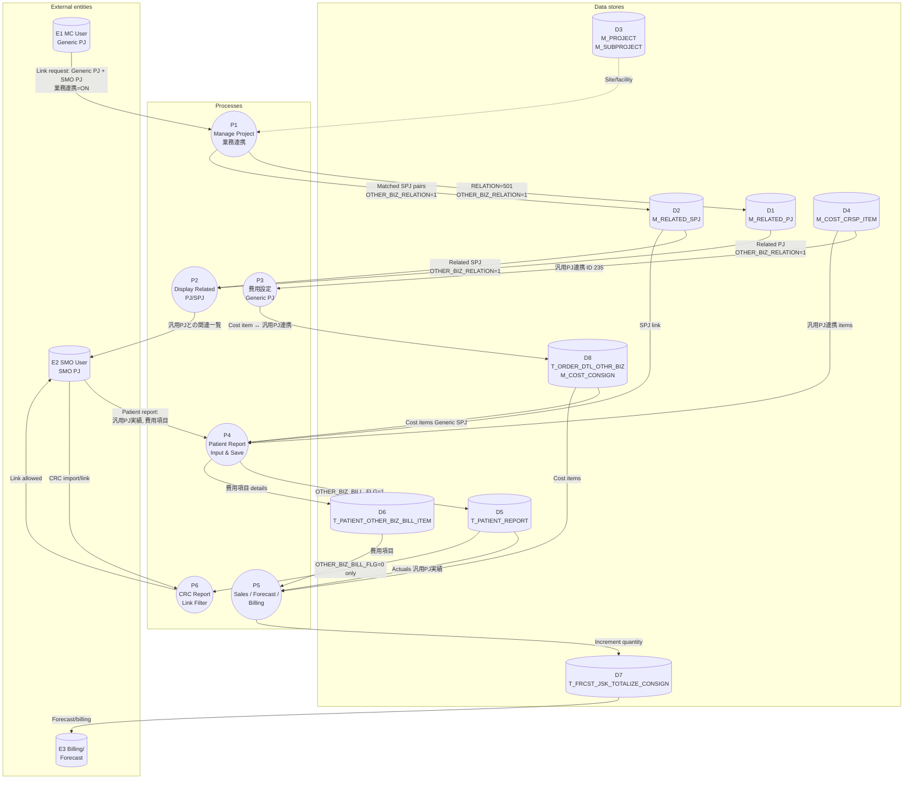
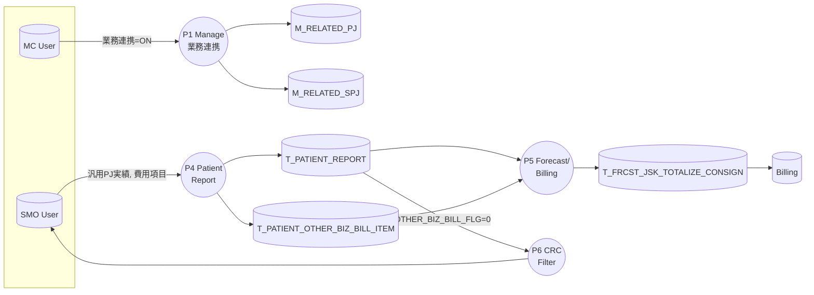

# Data Flow Diagram: 8981 業務連携 (OS Overall Survival Follow-up)

This document contains Data Flow Diagrams (DFD) for the **8981-OS-Overall-Survival-follow-up** branch: SMO/MC project linking (業務連携), Subject Handling Report (汎用PJ実績), and consolidated billing.

---

## Level 0 — Context Diagram

Single process = SMOMO system. External entities = MC User (Generic PJ), SMO User (SMO PJ), Billing/Forecast.

---

## Level 1 — Main Processes and Data Stores

Processes: P1 Manage PJ/SPJ links, P2 Display Related PJ/SPJ, P3 費用設定, P4 Patient Report, P5 Sales/Forecast/Billing, P6 CRC link filter.

---

## Level 1 — Simplified by process (left-to-right)

Same Level 1 flows, arranged for readability.

---

## Data flow summary (for drawing tools)

| From        | To  | Data |
|------------|-----|------|
| MC User    | P1  | 業務連携=ON, SMO PJ selection |
| P1         | M_RELATED_PJ | RELATION=501, OTHER_BIZ_RELATION=1 |
| P1         | M_RELATED_SPJ | SPJ pairs (same site/facility), OTHER_BIZ_RELATION=1 |
| M_RELATED_PJ, M_RELATED_SPJ | P2 | Related Generic PJ/SPJ (read) |
| P2         | SMO User | 汎用PJとの関連一覧 |
| M_COST_CRSP_ITEM | P3, P4 | 汎用PJ連携 (235), cost item list |
| SMO User   | P4  | Patient report (汎用PJ実績, 費用項目) |
| P4         | T_PATIENT_REPORT | Report + OTHER_BIZ_BILL_FLG |
| P4         | T_PATIENT_OTHER_BIZ_BILL_ITEM | 費用項目 lines (when 汎用PJ実績=ON) |
| T_PATIENT_REPORT, T_PATIENT_OTHER_BIZ_BILL_ITEM | P5 | Actuals for Generic SPJ |
| P5         | T_FRCST_JSK_TOTALIZE_CONSIGN | Quantity increment for Generic SPJ |
| T_PATIENT_REPORT | P6 | Filter: OTHER_BIZ_BILL_FLG=0 for CRC link |

---

## Notation

- **External entity:** Rounded rectangle (source/sink of data).
- **Process:** Rounded rectangle (transforms data).
- **Data store:** Cylinder (database/table).
- **Arrow:** Data flow (label on arrow).
- **Dotted arrow:** Read/reference (e.g. site/facility lookup).

To view the Mermaid diagrams: open this file in VS Code (with Mermaid extension), GitHub, or any Mermaid-compatible viewer.
